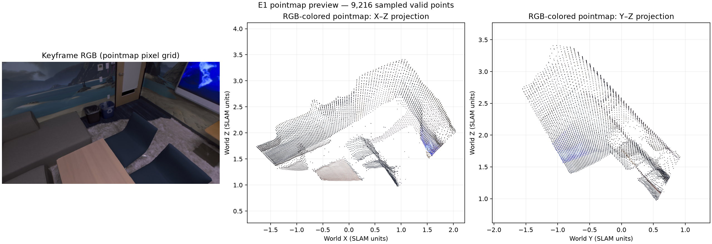

# E1 — Replica office0 RGB pilot

**판정: SLAM export 완료, RGB·좌표 정합 점검 통과.** Run `E0a-readiness-20261104-002`의 `E1_slam_export` stage를 호스트 GPU에서 실행했습니다. E1은 추론 실행 및 export를 확인하는 단계이며, semantic 분할이나 GT 기준 정확도 평가는 포함하지 않습니다.

## 실행 고정 정보

- MASt3R-SLAM commit: `e6f4e3d474fad0e11f561482012be864ba8c3f17` (깨끗한 checkout)
- Python 3.11.18; PyTorch 2.7.1+cu128; CUDA runtime 12.8
- GPU: NVIDIA GeForce RTX 5060, 8151 MiB; driver 595.99.02
- Input: Replica office0 첫 30장 RGB만 PNG로 변환한 E0a 산출물
- Config: upstream `config/base.yaml`; run 전용 설정에서 `single_thread: true`
- Keyframe buffer 32, low-VRAM cache 동기화 사용
- Elapsed 16.88초; 200 ms 주기 `nvidia-smi` host-wide memory 샘플 peak 4060 MiB
- 실험 저장소 run 시작 commit: `c5bd24c463e6840b3560f0f51b8c65ae3a6893dd` (작업 트리 변경 존재; 아래 핵심 파일 hash로 실행 코드 고정)

실행 인자와 upstream/launcher hash는 [`run_arguments.json`](../../../runs/semantic_region_pointmap/E0a-readiness-20261104-002/stages/E1_slam_export/artifacts/run_arguments.json), 성능 요약은 [`performance.json`](../../../runs/semantic_region_pointmap/E0a-readiness-20261104-002/stages/E1_slam_export/artifacts/performance.json)에 있습니다. GPU 측정은 host 전체 `memory.used` 샘플이며 프로세스 단독 VRAM 측정은 아닙니다.

실행기 hash: `scripts/run_slam_export.py` `c0c470d4797f1f600b72c2c7e050065e3435a56b51d3b78a4c74f694b1f31876`; `scripts/run_slam_export.sh` `643708853a91b592eec602ecb1e770143935f5b254284ba3a1fcbbb849d84f12`; `src/semantic_region_export.py` `bc04f385b71e3d4ee63ce097eb1eec856f3eec243fe94c1a7b881fe4f28cb31c`; 설정 `e36968eeb517621a5099142420000c9f951fb7c6c76fde8460ea0545dad0cdba`.

## Export와 정합 확인

- 30개 입력 frame을 처리했고 Keyframe 1개(frame 0, timestamp 0.0)가 생성됐습니다. 해당 Keyframe의 `fusion_count`와 `update_count`는 모두 30입니다.
- Export grid는 288×512입니다. 모든 147,456개 픽셀이 finite local/world point 및 confidence를 가져 유효 mask에 포함됐습니다.
- Export RGB와 upstream Keyframe PNG가 픽셀 단위로 정확히 일치했습니다.
- 저장된 `pose_sim3_raw`로 `lietorch.Sim3.act(point_local)`을 다시 계산했을 때 `point_world`와 최대 절대 오차가 0이었습니다.
- 상위 호환 PLY에는 confidence threshold 뒤 146,382점, trajectory에는 Keyframe 행 1개가 있습니다. 원본 unthresholded pointmap은 NPZ에 따로 보존했습니다.
- NPZ SHA-256: `fa8a417272281bda95102b0806060945465c3e652a8a1fcb37bceb9915f1746c9`.

배열은 [`pointmaps/keyframes/`](../../../runs/semantic_region_pointmap/E0a-readiness-20261104-002/stages/E1_slam_export/artifacts/pointmaps/keyframes/)에 있고, 공식 PLY/trajectory/RGB는 [`upstream_output/`](../../../runs/semantic_region_pointmap/E0a-readiness-20261104-002/stages/E1_slam_export/artifacts/upstream_output/)에 있습니다. [`validate_e1_export.py`](../../../scripts/validate_e1_export.py)는 위 확인을 읽기 전용으로 재현합니다.

아래는 같은 keyframe의 RGB와 RGB 색상을 입힌 world pointmap 투영입니다. 점은 시각화를 위해 stride 4로 샘플링했습니다.

## 범위

이번 30-frame pilot에서는 최종 Keyframe이 하나라 다중 Keyframe pose 변화, loop closure 후 정합, temporal Region association은 검증하지 않았습니다. E2에서는 이 동일한 E1 산출물을 입력으로 SAB3R 의미 추론을 진행할 수 있습니다. GT 기하 오차는 이후 평가 단계에서 별도로 측정해야 합니다.
